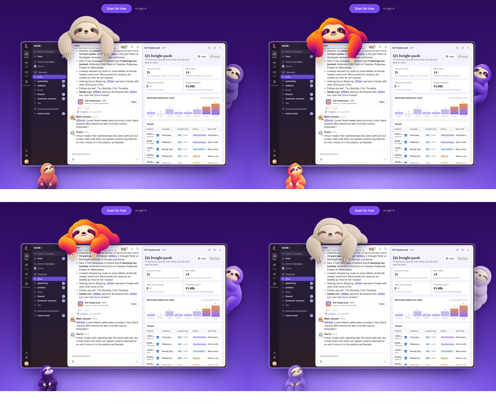
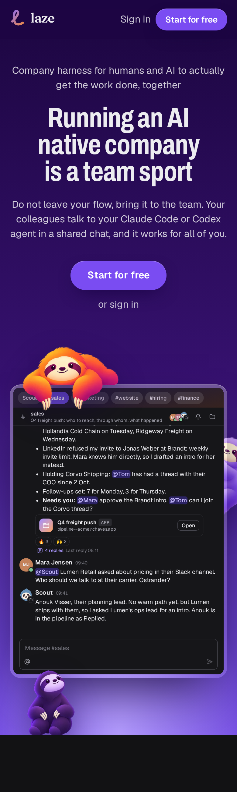
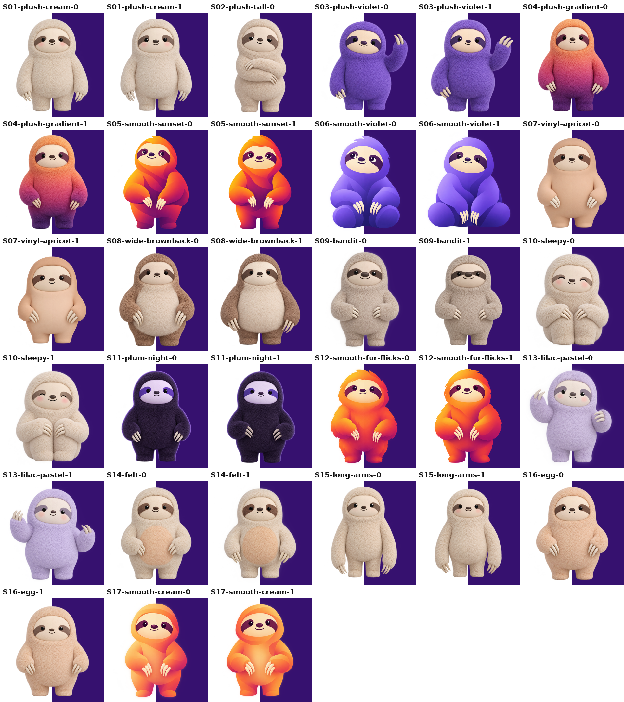
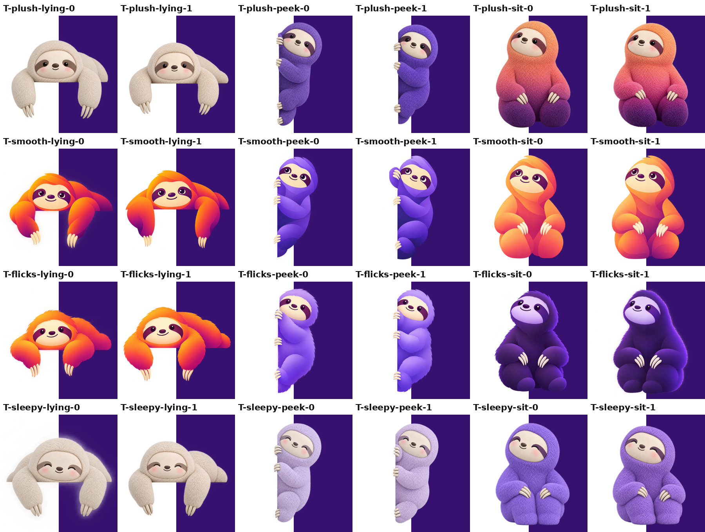

# Laze sloth, round 4

Sloth versions of the Meta Muse mascot: plush hooded body, flat pale face panel, dot eyes, now with a sloth eye mask, nose and claws. Some keep the plush fur, some mix in the smooth Firefox gradient look.

## Team mode (three sloths around the demo)

- [team-plush](https://laze.langwatch.ai/?mascot=team-plush) (my pick): cream on top, purple peeking from the side, sunset gradient sitting below
- [team-smooth](https://laze.langwatch.ai/?mascot=team-smooth): smooth gradient look, sunset, violet and peach
- [team-flicks](https://laze.langwatch.ai/?mascot=team-flicks): smooth gradient with fur at the edges, orange, lilac and night plum
- [team-sleepy](https://laze.langwatch.ai/?mascot=team-sleepy): plush with closed happy eyes, cream, lilac and purple

## One sloth on the demo edge

- [plush](https://laze.langwatch.ai/?mascot=plush), cream plush
- [plush-violet](https://laze.langwatch.ai/?mascot=plush-violet), Laze purple plush
- [plush-gradient](https://laze.langwatch.ai/?mascot=plush-gradient), plush dyed purple to orange
- [smooth](https://laze.langwatch.ai/?mascot=smooth), smooth sunset gradient
- [smooth-violet](https://laze.langwatch.ai/?mascot=smooth-violet), smooth violet, sitting
- [flicks](https://laze.langwatch.ai/?mascot=flicks), smooth gradient with fur at the edges
- [sleepy](https://laze.langwatch.ai/?mascot=sleepy), closed happy eyes
- [lilac](https://laze.langwatch.ai/?mascot=lilac), pastel lilac plush
- [plum](https://laze.langwatch.ai/?mascot=plum), dark plum plush with a lilac face
- [long-arms](https://laze.langwatch.ai/?mascot=long-arms), real sloth arms

## Sheets

All 31 first-round candidates:

Team poses (lying, peeking, sitting), two tries each:

