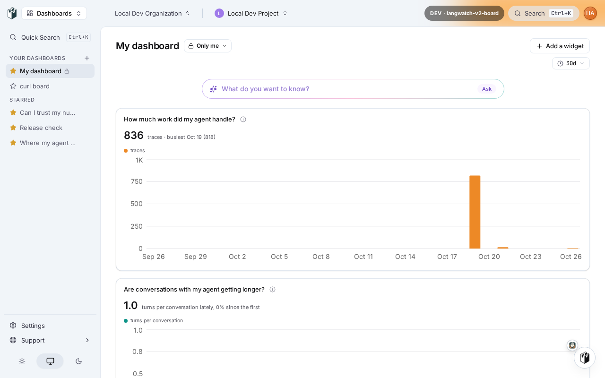
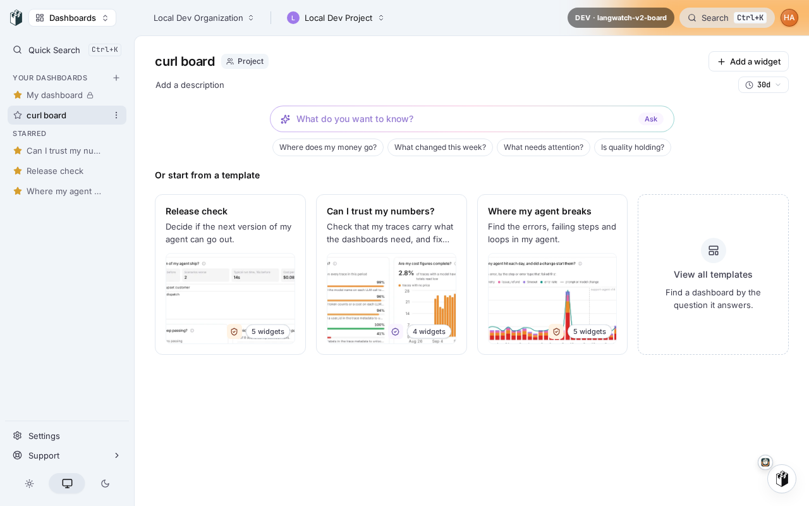

# PR 8896 live proof, head 66f4a3333bd

Stack: haven up (worktree langwatch-v2-board). API key: haven local dev project key (redacted as $K in curl lines).

Note: brief's literal path /api/v1/2026-08-07/dashboards answers 404 (not a route); the dated address is /api/v1/dashboards/<date> (packages/api/src/rest/addressing.ts), used below.

## Line 1: CLI dashboards (head 66f4a3333bd)

$ node dist/cli/index.js dashboards create Proof board 8896 -f json
{
  "id": "dashboard_0002MA0lyndEESVatOeUQhq8hr8ky",
  "name": "Proof board 8896",
  "description": null,
  "scope": "PROJECT",
  "createdById": null,
  "createdAt": "2026-10-26T12:14:48.769Z",
  "updatedAt": "2026-10-26T12:14:48.769Z",
  "platformUrl": "https://app.langwatch-v2-board.langwatch.localhost/local-dev-project/dashboards/dashboard_0002MA0lyndEESVatOeUQhq8hr8ky"
}

[exit 0]

$ node dist/cli/index.js dashboards list -f json
{
  "data": [
    {
      "id": "dashboard_0002MA0lyndEESVatOeUQhq8hr8ky",
      "name": "Proof board 8896",
      "description": null,
      "scope": "PROJECT",
      "createdById": null,
      "createdAt": "2026-10-26T12:14:48.769Z",
      "updatedAt": "2026-10-26T12:14:48.769Z",
      "platformUrl": "https://app.langwatch-v2-board.langwatch.localhost/local-dev-project/dashboards/dashboard_0002MA0lyndEESVatOeUQhq8hr8ky",
      "widgetCount": 0
    }
  ]
}

[exit 0]

$ node dist/cli/index.js dashboards get dashboard_0002MA0lyndEESVatOeUQhq8hr8ky -f json
{
  "id": "dashboard_0002MA0lyndEESVatOeUQhq8hr8ky",
  "name": "Proof board 8896",
  "description": null,
  "scope": "PROJECT",
  "createdById": null,
  "createdAt": "2026-10-26T12:14:48.769Z",
  "updatedAt": "2026-10-26T12:14:48.769Z",
  "platformUrl": "https://app.langwatch-v2-board.langwatch.localhost/local-dev-project/dashboards/dashboard_0002MA0lyndEESVatOeUQhq8hr8ky"
}

[exit 0]

$ node dist/cli/index.js dashboards update dashboard_0002MA0lyndEESVatOeUQhq8hr8ky --name Proof board renamed -f json
{
  "id": "dashboard_0002MA0lyndEESVatOeUQhq8hr8ky",
  "name": "Proof board renamed",
  "description": null,
  "scope": "PROJECT",
  "createdById": null,
  "createdAt": "2026-10-26T12:14:48.769Z",
  "updatedAt": "2026-10-26T12:14:49.398Z",
  "platformUrl": "https://app.langwatch-v2-board.langwatch.localhost/local-dev-project/dashboards/dashboard_0002MA0lyndEESVatOeUQhq8hr8ky"
}

[exit 0]

$ node dist/cli/index.js dashboards widgets create dashboard_0002MA0lyndEESVatOeUQhq8hr8ky --name W1 --code-file /tmp/p8896/w.tsx --queries-file /tmp/p8896/q.json -f json
{
  "id": "widget_0002MAWwZSm6d7GwJiP4p5X1OfWmB",
  "name": "W1",
  "definition": {
    "version": 1,
    "code": "export default function W(){return <div>hi</div>}\n",
    "queries": [],
    "source": {
      "kind": "api"
    }
  },
  "createdAt": "2026-10-26T12:14:49.618Z",
  "updatedAt": "2026-10-26T12:14:49.618Z",
  "platformUrl": "https://app.langwatch-v2-board.langwatch.localhost/local-dev-project/analytics/reports",
  "dashboardId": "dashboard_0002MA0lyndEESVatOeUQhq8hr8ky",
  "gridColumn": 0,
  "gridRow": 0,
  "colSpan": 4,
  "rowSpan": 3
}

[exit 0]

$ node dist/cli/index.js dashboards widgets list dashboard_0002MA0lyndEESVatOeUQhq8hr8ky -f json
{
  "data": [
    {
      "id": "widget_0002MAWwZSm6d7GwJiP4p5X1OfWmB",
      "name": "W1",
      "definition": {
        "version": 1,
        "code": "export default function W(){return <div>hi</div>}\n",
        "queries": [],
        "source": {
          "kind": "api"
        }
      },
      "
[exit 0]

$ node dist/cli/index.js dashboards widgets delete dashboard_0002MA0lyndEESVatOeUQhq8hr8ky widget_0002MAWwZSm6d7GwJiP4p5X1OfWmB
{"id":"widget_0002MAWwZSm6d7GwJiP4p5X1OfWmB","deleted":true}

[exit 0]

$ node dist/cli/index.js dashboards widgets list dashboard_0002MA0lyndEESVatOeUQhq8hr8ky -f json
{
  "data": []
}

[exit 0]

$ node dist/cli/index.js dashboards delete dashboard_0002MA0lyndEESVatOeUQhq8hr8ky
{"id":"dashboard_0002MA0lyndEESVatOeUQhq8hr8ky","name":"Proof board renamed"}

[exit 0]

$ node dist/cli/index.js dashboards get dashboard_0002MA0lyndEESVatOeUQhq8hr8ky -f json
{
  "ok": false,
  "error": {
    "code": "dashboard_not_found",
    "kind": "dashboard_not_found",
    "message": "Dashboard not found",
    "httpStatus": 404,
    "meta": {
      "projectId": "local-dev-project"
    },
    "isHandled": true,
    "retryable": false,
    "traceId": "d3d5c97dc860f2d94b4eb4a181f7f405",
    "terminal": true
  }
}
Failed to fetch board: Dashboard not found

[exit 1]


## Line 2: MCP over stdio (real server dist/index.js, MCP SDK client)
```
tools: platform_list_dashboards, platform_get_dashboard, platform_create_dashboard, platform_delete_dashboard, platform_rename_dashboard, list_dashboard_boards, add_dashboard_widget, update_dashboard_widget, get_dashboard_board, create_dashboard_board, rename_dashboard_board, delete_dashboard_board, list_board_widgets, delete_dashboard_widget

> list_dashboard_boards {} isError=false
# Dashboards (1 total)

## curl board
**ID**: dashboard_0002MEgJIlv7oNNhiGPly944vAcwc
**Widgets**: 0
**URL**: https://app.langwatch-v2-board.langwatch.localhost/local-dev-project/dashboards/dashboard_0002MEgJIlv7oNNhiGPly944vAcwc

> Pass the ID to `add_dashboard_widget` to add a widget to that dashboard.

> create_dashboard_board {"name":"MCP proof board"} isError=false
Board created.

**Name**: MCP proof board
**ID**: dashboard_0002MmPPjuE9f71AIyFvWz1PnzoIM
**Scope**: PROJECT
**URL**: https://app.langwatch-v2-board.langwatch.localhost/local-dev-project/dashboards/dashboard_0002MmPPjuE9f71AIyFvWz1PnzoIM

> Pass the ID to `add_dashboard_widget` to add a widget to it.

> list_dashboard_boards {} isError=false
# Dashboards (2 total)

## curl board
**ID**: dashboard_0002MEgJIlv7oNNhiGPly944vAcwc
**Widgets**: 0
**URL**: https://app.langwatch-v2-board.langwatch.localhost/local-dev-project/dashboards/dashboard_0002MEgJIlv7oNNhiGPly944vAcwc

## MCP proof board
**ID**: dashboard_0002MmPPjuE9f71AIyFvWz1PnzoIM
**Widgets**: 0
**URL**: https://app.langwatch-v2-board.langwatch.localhost/local-dev-project/dashboards/dashboard_0002MmPPjuE9f71AIyFvWz1PnzoIM

> Pass the ID to `add_dashboard_widget` to add a widget t

> rename_dashboard_board {"boardId":"dashboard_0002MmPPjuE9f71AIyFvWz1PnzoIM","name":"MCP renamed"} isError=false
Board updated.

**Name**: MCP renamed
**ID**: dashboard_0002MmPPjuE9f71AIyFvWz1PnzoIM
**Scope**: PROJECT
**URL**: https://app.langwatch-v2-board.langwatch.localhost/local-dev-project/dashboards/dashboard_0002MmPPjuE9f71AIyFvWz1PnzoIM

> list_board_widgets {"boardId":"dashboard_0002MmPPjuE9f71AIyFvWz1PnzoIM"} isError=false
Board "dashboard_0002MmPPjuE9f71AIyFvWz1PnzoIM" has no widgets.

> delete_dashboard_board {"boardId":"dashboard_0002MmPPjuE9f71AIyFvWz1PnzoIM"} isError=false
Board "MCP renamed" deleted with its widgets (ID: dashboard_0002MmPPjuE9f71AIyFvWz1PnzoIM).
```

## Lines 3, 4, 7 curl
```

$ curl http://127.0.0.1:36467/api/v1/dashboards
status: 200 xav=latest st=latest
{"data":[{"id":"dashboard_0002MEgJIlv7oNNhiGPly944vAcwc","name":"curl board","description":null,"scope":"PROJECT","createdById":null,"createdAt":"2026-10-26T12:14:57.671Z","updatedAt":"2026-10-26T12:14:57.671Z","platformUrl":"https://app.langwatch-v2-board.langwatch.localhost/local-dev-project/dashb

$ curl http://127.0.0.1:36467/api/v1/dashboards -H X-API-Version: 2026-10-26
status: 200 xav=2026-10-26 st=stable
{"data":[{"id":"dashboard_0002MEgJIlv7oNNhiGPly944vAcwc","name":"curl board","description":null,"scope":"PROJECT","createdById":null,"createdAt":"2026-10-26T12:14:57.671Z","updatedAt":"2026-10-26T12:14:57.671Z","platformUrl":"https://app.langwatch-v2-board.langwatch.localhost/local-dev-project/dashb

$ curl http://127.0.0.1:36467/api/v1/dashboards -H X-API-Version: 2026-08-07
status: 200 xav=2026-08-07 st=stable
{"data":[]}

$ curl http://127.0.0.1:36467/api/v1/dashboards -H X-API-Version: 2026-13-45
status: 400 xav= st=
{"type":"bad_request","code":"invalid_api_version","message":"The API version must be latest or a real date in YYYY-MM-DD form","retryable":false,"fault":"customer"}

$ curl http://127.0.0.1:36467/api/v1/2026-08-07/dashboards -H X-API-Version: 2026-10-26
status: 404 xav= st=
{"error":"Not Found"}

$ curl http://127.0.0.1:36467/api/v1/analytics/reports
status: 200 xav=2026-08-07 st=stable
{"data":[]}

$ curl -X POST http://127.0.0.1:36467/api/v1/analytics -H content-type: application/json -d {"startDate":1700000000000,"endDate":1700600000000,"series":[{"metric":"metadata.trace_id","aggregation":"cardinality"}]}
status: 400 xav=2026-08-07 st=stable
{"error":"Validation error: Invalid input: expected string, received undefined at \"timeZone\""}

$ curl http://127.0.0.1:36467/api/v1/boards
status: 404 xav= st=
{"error":"Not Found"}

$ curl http://127.0.0.1:36467/api/v1/analytics/reports -H X-API-Version: 2026-10-26
status: 200 xav=2026-08-07 st=stable
{"data":[]}

$ curl -X POST http://127.0.0.1:36467/api/v1/analytics -H X-API-Version: 2026-10-26 -H content-type: application/json -d {"startDate":1700000000000,"endDate":1700600000000,"series":[{"metric":"metadata.trace_id","aggregation":"cardinality"}]}
status: 400 xav=2026-08-07 st=stable
{"error":"Validation error: Invalid input: expected string, received undefined at \"timeZone\""}

$ curl http://127.0.0.1:36467/api/v1/projects/local-dev-project/analytics/boards -H X-API-Version: 2026-10-26
status: 200 xav=2026-08-07 st=stable
{"data":[{"id":"dashboard_0002MEgJIlv7oNNhiGPly944vAcwc","name":"curl board","description":null,"scope":"PROJECT","createdById":null,"createdAt":"2026-10-26T12:14:57.671Z","updatedAt":"2026-10-26T12:14:57.671Z","platformUrl":"https://app.langwatch-v2-board.langwatch.localhost/local-dev-project/dashb

$ curl -X POST http://127.0.0.1:36467/api/v1/agents/agent_nonexistent/test -H X-API-Version: 2026-10-26 -H content-type: application/json -d {}
status: 404 xav=2026-08-07 st=stable
{"type":"not_found","code":"agent_not_found","message":"Agent \"agent_nonexistent\" was not found in project \"local-dev-project\".","retryable":false,"meta":{"agentId":"agent_nonexistent","projectId":"local-dev-project"},"trace_id":"8c214a35e5c0ad5903775cd5336af9ab","span_id":"f15e2e16a656565b","tr

## reruns
$ curl -X POST http://127.0.0.1:36467/api/v1/analytics -H content-type: application/json -d {"startDate":1700000000000,"endDate":1700600000000,"timeZone":"UTC","series":[{"metric":"metadata.trace_id","aggregation":"cardinality"}]}
status: 200 xav=2026-08-07 st=stable
{"currentPeriod":[],"previousPeriod":[]}

$ curl -X POST http://127.0.0.1:36467/api/v1/analytics -H X-API-Version: 2026-10-26 -H content-type: application/json -d {"startDate":1700000000000,"endDate":1700600000000,"timeZone":"UTC","series":[{"metric":"metadata.trace_id","aggregation":"cardinality"}]}
status: 200 xav=2026-08-07 st=stable
{"currentPeriod":[],"previousPeriod":[]}

$ curl http://127.0.0.1:36467/api/v1/2026-08-07/analytics/reports -H X-API-Version: 2026-10-26
status: 404 xav= st=
{"error":"Not Found"}

$ curl http://127.0.0.1:36467/api/v1/2026-08-07/dashboards
status: 404 xav= st=
{"error":"Not Found"}

$ curl http://127.0.0.1:36467/api/v1/2026-10-26/dashboards
status: 404 xav= st=
{"error":"Not Found"}

$ curl http://127.0.0.1:36467/api/v1/2026-10-26/dashboards -H X-API-Version: 2026-10-26
status: 404 xav= st=
{"error":"Not Found"}

$ curl http://127.0.0.1:36467/api/v1/2026-10-26/dashboards -H X-API-Version: 2026-08-07
status: 404 xav= st=
{"error":"Not Found"}

$ curl http://127.0.0.1:36467/api/v1/latest/dashboards -H X-API-Version: 2026-10-26
status: 404 xav= st=
{"error":"Not Found"}

## dated path form (base/<date>), per addressing.ts
$ curl http://127.0.0.1:36467/api/v1/dashboards/2026-10-26 -H X-API-Version: 2026-08-07
status: 400 xav= st=
{"type":"bad_request","code":"api_version_conflict","message":"The API version in the URL and header must match","retryable":false,"fault":"customer"}

$ curl http://127.0.0.1:36467/api/v1/dashboards/2026-08-07 -H X-API-Version: 2026-10-26
status: 400 xav= st=
{"type":"bad_request","code":"api_version_conflict","message":"The API version in the URL and header must match","retryable":false,"fault":"customer"}

$ curl http://127.0.0.1:36467/api/v1/dashboards/2026-10-26 -H X-API-Version: 2026-10-26
status: 200 xav=2026-10-26 st=stable
{"data":[{"id":"dashboard_0002MEgJIlv7oNNhiGPly944vAcwc","name":"curl board","description":null,"scope":"PROJECT","createdById":null,"createdAt":"2026-10-26T12:14:57.671Z","updatedAt":"2026-10-26T12:14:57.671Z","platformUrl":"https://app.langwatch-v2-board.langwatch.localhost/local-dev-project/dashb

$ curl http://127.0.0.1:36467/api/v1/dashboards/2026-10-26
status: 200 xav=2026-10-26 st=stable
{"data":[{"id":"dashboard_0002MEgJIlv7oNNhiGPly944vAcwc","name":"curl board","description":null,"scope":"PROJECT","createdById":null,"createdAt":"2026-10-26T12:14:57.671Z","updatedAt":"2026-10-26T12:14:57.671Z","platformUrl":"https://app.langwatch-v2-board.langwatch.localhost/local-dev-project/dashb

$ curl http://127.0.0.1:36467/api/dashboards/2026-08-07 -H X-API-Version: 2026-10-26
status: 400 xav= st=
{"type":"bad_request","code":"api_version_conflict","message":"The API version in the URL and header must match","retryable":false,"fault":"customer"}

$ curl http://127.0.0.1:36467/api/v1/analytics/reports/2026-08-07 -H X-API-Version: 2026-10-26
status: 404 xav=2026-08-07 st=stable
{"type":"not_found","code":"dashboard_not_found","message":"Dashboard not found","retryable":false,"meta":{"projectId":"local-dev-project"},"trace_id":"9044fe5c0db8d9738de8c4209d02ca3a","span_id":"c6d3b7acbca953ce","trace":{"traceId":"9044fe5c0db8d9738de8c4209d02ca3a","spanId":"c6d3b7acbca953ce"},"f

$ curl http://127.0.0.1:36467/api/v1/dashboards/latest -H X-API-Version: 2026-10-26
status: 200 xav=latest st=latest
{"data":[{"id":"dashboard_0002MEgJIlv7oNNhiGPly944vAcwc","name":"curl board","description":null,"scope":"PROJECT","createdById":null,"createdAt":"2026-10-26T12:14:57.671Z","updatedAt":"2026-10-26T12:14:57.671Z","platformUrl":"https://app.langwatch-v2-board.langwatch.localhost/local-dev-project/dashb

```

## Line 6
```

$ node dist/cli/index.js organization list
error: unknown command 'list'

Usage: langwatch organization [options] [command]

Read and update the organization profile

Options:
  -h, --help             display help for command

Global Options:
  -v, --version          Display the current version
  -o, --output <format>  Output format: table (default), json, agents (compact
                         single-line JSON), or yaml (choices: "table", "json",
                         "agents", "yaml")
  --json <fields>        Emit JSON with only t
[exit 1]

$ node dist/cli/index.js projects list
{"ok":false,"error":{"code":"credential_class_mismatch","kind":"credential_class_mismatch","message":"Failed to list projects: This endpoint requires an organization API key, and a project key was presented.","httpStatus":401,"meta":{"trace_id":"d22f5f372ecf6d1b048dc5f00f7f744a","span_id":"3888a9a2715369ce"},"isHandled":true,"retryable":false,"traceId":"d22f5f372ecf6d1b048dc5f00f7f744a","terminal"
[exit 1]

$ node dist/cli/index.js organization get
{"ok":false,"error":{"code":"credential_class_mismatch","kind":"credential_class_mismatch","message":"Failed to fetch the organization: This endpoint requires an organization API key, and a project key was presented.","httpStatus":401,"meta":{"trace_id":"65b7c0308bc6b5868d04b4c696afb520","span_id":"
[exit 1]

$ node dist/cli/index.js status
{"attention":{"erroredTraces24h":0,"runningExperiments":[],"budgetsAtRisk":[],"errors":{},"advisories":{}},"resources":{"evaluators":{"count":5},"secrets":{"count":0,"error":"The query parameters didn't match the expected shape.","status":422},"suites":{"count":40},"datasets":{"count":0},"agents":{"
[exit 0]

$ node dist/cli/index.js dashboard list
{"data":[]}

[exit 0]

$ node dist/cli/index.js agents list
error: unknown command 'agents'
(Did you mean agent?)

Usage: langwatch [options] [command]

LangWatch CLI - Manage prompts, datasets, evaluators, scenarios, test suites,
and more

Options:
  -v, --version                  Display the current version
  -o, --output <format>          Output format: t
[exit 1]

$ node dist/cli/index.js scenario list
[{"id":"scenario_0003Wt7GWUxxiAVxUJ5tVofetEF2H","name":"E2E core 645: creates a scenario then runs it over 2 turns","situation":"You are a LangWatch user talking to Langy, the in-product assistant. The test state is the test's own bookkeeping: take only the values the instructions below name, never 
[exit 0]

$ curl http://127.0.0.1:36467/api/v1/agents/latest 
{"type":"not_found","code":"agent_not_found","message":"Agent \"latest\" was not found in project \"local-dev-project\".","retryable":false,"meta":{"agentId":"latest","projectId":"local-dev-project"},
$ curl http://127.0.0.1:36467/api/v1/agents/latest -H 'X-API-Version: 2026-10-26'
{"type":"not_found","code":"agent_not_found","message":"Agent \"latest\" was not found in project \"local-dev-project\".","retryable":false,"meta":{"agentId":"latest","projectId":"local-dev-project"},
```

## Line 5
```
$ curl -i http://127.0.0.1:42461/api/v1/dashboards 
{"type":"not_found","code":"dashboards_not_released","message":"Not found","retryable":false,"trace_id":"6d6d04bd53f68a17421962f98852e933","span_id":"942ebabc4ab9b2ad","trace":{"traceId":"6d6d04bd53f68a17421962f98852e933","spanId":"942ebabc4ab9b2ad"},"fault":"customer"} [404]

$ curl -i http://127.0.0.1:42461/api/v1/dashboards -H 'X-API-Version: 2026-10-26'
{"type":"not_found","code":"dashboards_not_released","message":"Not found","retryable":false,"trace_id":"17ac46a3cb8fc2cbee4bce649f31b375","span_id":"6f25183c9b53d6d6","trace":{"traceId":"17ac46a3cb8fc2cbee4bce649f31b375","spanId":"6f25183c9b53d6d6"},"fault":"customer"} [404]

$ curl /api/v1/analytics/reports (control, should still work)
{"data":[]} [200]
```

## Line 8
 

---
## Follow-up on head 99d6255b556

## (a) line 6: org API key created in UI (Settings > API keys, Personal, scope Organization, 7 days); key redacted
```
$ node dist/cli/index.js organization get
Using API key from LANGWATCH_API_KEY. Switch: langwatch login --project | --device
{"ok":false,"error":{"code":"enterprise_plan_required","kind":"enterprise_plan_required","message":"Failed to fetch the organization: The management API requires an Enterprise plan","httpStatus":402,"meta":{"feature":"MANAGEMENT_API"},"isHandled":true,"retryable":false,"traceId":"7c1c3b80227535a9943e73942c582334","suggestions":["This part of the API is available on the Enterprise plan; meta.feature names which capability was refused","Talk to your account team or visit the pricing page to upgrade the organization's plan"],"docUrl":"https://langwatch.ai/docs/pricing","terminal":true}}
Failed to fetch the organization: The management API requires an Enterprise plan

[exit 1]

```
## (b) widget create platformUrl
```
$ node dist/cli/index.js dashboards widgets create dashboard_0002Slvj92kMPiGYFZPb9CHiVIyWm --name W1 --code-file /tmp/p8896/w.tsx --queries-file /tmp/p8896/q.json -f json
{
  "id": "widget_0002Slvj92kMPiGYFZPb9CHiVIyWn",
  "name": "W1",
  "definition": {
    "version": 1,
    "code": "export default function W(){return <div>hi</div>}\n",
    "queries": [],
    "source": {
      "kind": "api"
    }
  },
  "createdAt": "2026-10-26T12:27:58.464Z",
  "updatedAt": "2026-10-26T12:27:58.464Z",
  "platformUrl": "https://app.langwatch-v2-board.langwatch.localhost/local-dev-project/dashboards/dashboard_0002Slvj92kMPiGYFZPb9CHiVIyWm",
  "dashboardId": "dashboard_0002Slvj92kMPiGYFZPb9CHiVIyWm",
  "gridColumn": 0,
  "gridRow": 0,
  "colSpan": 4,
  "rowSpan": 3
}

[exit 0]

```
## (c) line 3 re-run, real dated form
```
$ curl /api/v1/dashboards 
200 xav=latest {"data":[{"id":"dashboard_0002MEgJIlv7oNNhiGPly944vAcwc","name":"curl board","description":null,"scope":"PROJECT","createdById":null,"createdAt":"2026-10-26T12:
$ curl /api/v1/dashboards -H 'X-API-Version: 2026-10-26'
200 xav=2026-10-26 {"data":[{"id":"dashboard_0002MEgJIlv7oNNhiGPly944vAcwc","name":"curl board","description":null,"scope":"PROJECT","createdById":null,"createdAt":"2026-10-26T12:
$ curl /api/v1/dashboards -H 'X-API-Version: 2026-08-07'
200 xav=2026-08-07 {"data":[]}
$ curl /api/v1/dashboards -H 'X-API-Version: 2026-13-45'
400 xav= {"type":"bad_request","code":"invalid_api_version","message":"The API version must be latest or a real date in YYYY-MM-DD form","retryable":false,"fault":"custo
$ curl /api/v1/dashboards/2026-10-26 -H 'X-API-Version: 2026-08-07'
400 xav= {"type":"bad_request","code":"api_version_conflict","message":"The API version in the URL and header must match","retryable":false,"fault":"customer"}
```
